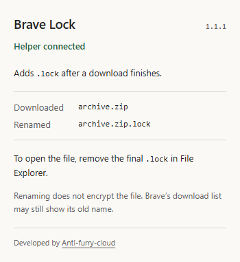

# Brave Lock

Adds `.lock` to files downloaded in Brave on Windows.

```text
archive.zip  ->  archive.zip.lock
photo.png    ->  photo.png.lock
```

Developed by [Anti-furry-cloud](https://github.com/Anti-furry-cloud).



## Install

Requires Windows 10 or 11, Brave, and .NET Framework 4.x. The release ZIP includes the helper executable. If you cloned the source, [build it first](#build-from-source).

1. Extract the release ZIP to a folder you intend to keep.
2. Remove any older Brave Lock extension from `brave://extensions`.
3. Run `Install.cmd`. It registers the helper for your Windows user; administrator access is not required.
4. Open `brave://extensions` and enable **Developer mode**.
5. Click **Load unpacked** and select the `extension` folder.
6. Open the extension popup. It should say **Helper connected**.

Download a small file and check its full name in File Explorer. To use the file, remove the final `.lock`. You may need to enable **File name extensions** in Explorer's View menu.

Keep the extracted folder in place. If you move it, run `Install.cmd` from its new location and reload the extension from that location.

## How it works

The extension listens for completed downloads and sends each file path to `BraveLockHost.exe`. The helper renames the file in the same directory, then exits. It does not read or change the file contents.

Renaming happens after the download finishes because Chromium can replace an extension-suggested suffix with one based on the response's MIME type. The file is downloaded once, under its normal name, before the helper adds `.lock`.

If another program, such as an antivirus scanner, still has the file open, the helper retries for about five seconds before reporting an error.

Files already ending in `.lock` are skipped. Existing files are never overwritten. If `archive.zip.lock` already exists, the helper uses `archive.zip (1).lock` instead.

## Permissions and local changes

| Permission | Used for |
| --- | --- |
| `downloads` | Receive completion events and read the completed file's path. |
| `nativeMessaging` | Ask the local helper to rename that file. |

The installer writes `native/local.brave_lock.json` with this installation's path and extension ID. It registers that manifest under:

```text
HKEY_CURRENT_USER\Software\Google\Chrome\NativeMessagingHosts\local.brave_lock
```

Brave reads this Chrome-compatible registry location. Only the extension ID listed in `allowed_origins` can connect through the browser. The helper itself can rename any local file your Windows user can rename; the extension only sends it the paths of completed downloads.

The extension and helper make no network requests and store no download history. There is no service, startup entry, or scheduled task. The helper runs only when called. The author link in the popup opens GitHub when clicked.

## Limits

- `.lock` changes the name, not the contents. It does not encrypt, scan, or disinfect files.
- The original file exists briefly before it is renamed. A browser setting that opens downloads automatically may open it first.
- Brave's download list may keep the old path. Its **Open** command can stop working after a rename; use File Explorer instead.
- Only downloads that finish while the extension is active are handled. Older downloads are not scanned.
- If the helper is missing or a file cannot be renamed, the extension shows `!`. The file can remain under its original name. The `!` stays until you open the popup, which shows the latest error.
- Network paths, symbolic links, junctions, and other reparse points are not supported.
- For private windows, enable **Allow in Private** in the extension's details.

## Troubleshooting

**Helper unavailable:** Run `Install.cmd` again and reopen the popup. Check that the helper executable and installation folder still exist.

**A file has no `.lock` suffix:** Open the popup to see the latest rename error. A connected helper does not prove that every previous download was renamed successfully.

**Upgrading from another folder:** Close any old helper process if one is still running, run the new `Install.cmd`, remove the old extension, and load the new `extension` folder. The new registration replaces the old one for your Windows user.

## Uninstall

Run `Uninstall.cmd` from the registered installation folder, then remove the extension from `brave://extensions`. It removes the registry entry and the generated `native/local.brave_lock.json`. Downloaded files keep their current names.

## Build from source

The helper uses the C# compiler supplied with .NET Framework. No NuGet packages are needed.

```powershell
powershell -NoProfile -ExecutionPolicy Bypass -File .\scripts\Build.ps1
```

This writes `native/BraveLockHost.exe`. Then follow the installation steps above.

The extension's public `key` keeps its ID stable when loaded unpacked. It is not a private signing key. If you change it, rerun `Install.cmd` so the native host permits the new ID.

## Tests

Build the helper first. With Node.js 22 or newer installed, run:

```powershell
node --test tests\*.test.cjs
```

The tests check native message framing, file contents, name conflicts, files held open by another process, rejected paths, download event handling, and the error badge. They use temporary files and do not register the helper or change a browser profile.

## References

- [Chrome downloads API](https://developer.chrome.com/docs/extensions/reference/api/downloads)
- [Native messaging](https://developer.chrome.com/docs/extensions/develop/concepts/native-messaging)
- [Chromium filename determination](https://github.com/chromium/chromium/blob/main/chrome/browser/download/download_target_determiner.cc)
